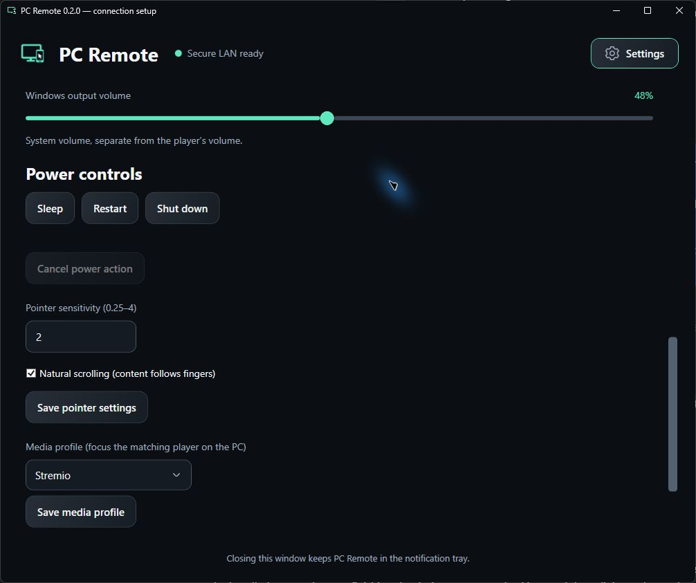
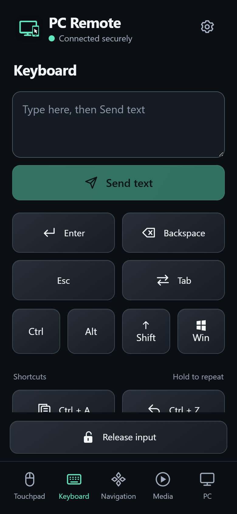
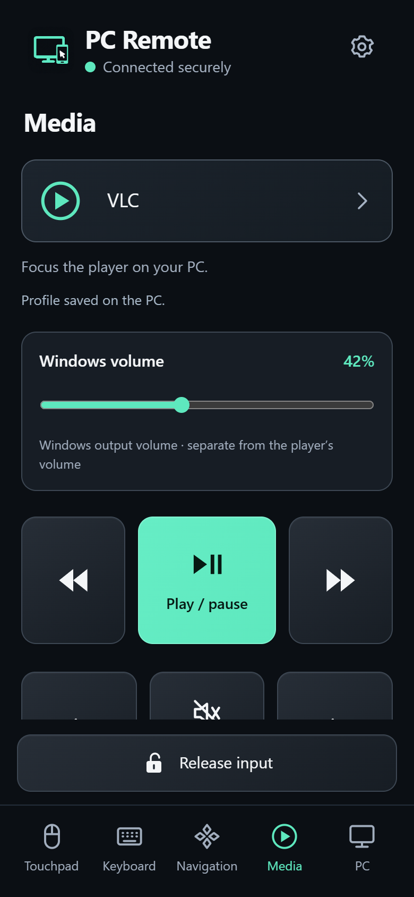
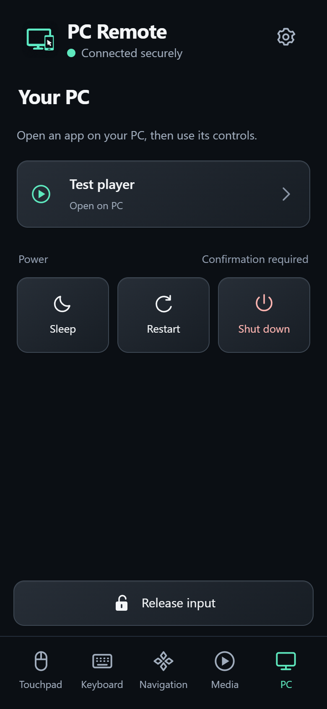
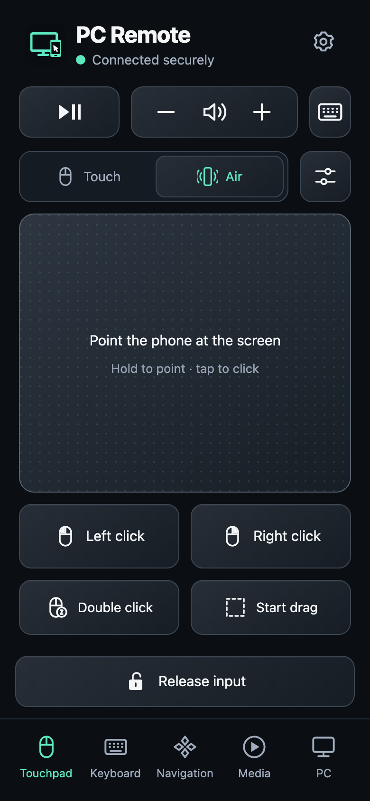
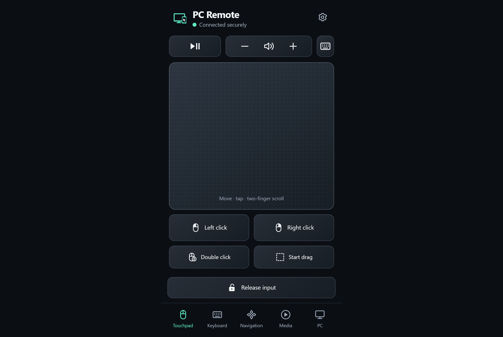
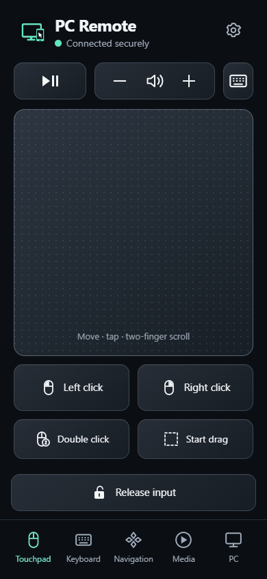

<div align="center">


# PC Remote

### Your computer. Controlled from your phone.

A touchpad, keyboard, media remote, and app launcher in the browser you already have.<br>
Pair on your computer, connect over your own network, and keep control within reach.<br>
<sub>Companions for Windows (primary), macOS and Ubuntu (experimental previews). Works from a phone, a tablet or another computer.</sub>

[](https://github.com/maamouribilel/pc-remote/releases/tag/v0.4.0)
[](#supported-environments)
[](#supported-environments)
[](#supported-environments)
[](#supported-environments)
[](#tech-stack)
[](#tech-stack)
[](#tech-stack)
[](docs/protocol.md)
[](LICENSE)

**[Download for Windows](https://github.com/maamouribilel/pc-remote/releases/download/v0.4.0/PCRemote-0.4.0-win-x64-setup.exe)** · **[macOS](https://github.com/maamouribilel/pc-remote/releases/download/v0.4.0/PCRemote-0.4.0-osx-arm64.zip)** · **[Ubuntu](https://github.com/maamouribilel/pc-remote/releases/download/v0.4.0/PCRemote-0.4.0-linux-x64.tar.gz)** · **[All versions](https://github.com/maamouribilel/pc-remote/releases)** · **[Watch the walkthrough](#walkthrough)** · **[Build from source](#getting-started)**



**A native companion on the computer you control. A browser remote on any device. One trusted local connection.**

</div>

---

## Made for the screen across the room

Watch your computer's screen while your phone handles the controls. Move the pointer, send text, navigate menus, switch media profiles, open configured apps, and adjust the system volume from five focused tabs.

PC Remote runs as a small companion on the computer you control (notification tray on Windows, menu bar on macOS, tray or window on Ubuntu) and serves its own browser interface. All application assets are bundled locally. Normal packaged operation needs no cloud account, subscription, Node.js installation, or separate .NET runtime.

## Supported environments

PC Remote has two halves: the **companion** that runs on the computer being controlled, and the **remote**, a web app the companion serves to any browser on the same trusted network. The table states what has actually been verified; everything else is still an open check.

| Companion (the computer you control) | Status | Verified so far |
| :--- | :--- | :--- |
| **Windows 10 1809 or later, x64** (Windows 11 tested) | Primary | Native input, audio, launcher and power; installer and portable ZIP; physical iPhone control on the 0.2.x previews; hosted Windows suites on every 0.3.x release |
| **macOS 14 or later, Apple Silicon** (tested on macOS 27) | Experimental | Quartz/Accessibility input, Core Audio, Keychain-backed storage; pairing and control from an iPhone on the developer's Mac; guarded native input smoke (41 checks) |
| **macOS 14 or later, Intel** | Experimental, not run on Intel hardware | Cross-built, inventory-checked, metadata startup under Rosetta emulation only |
| **Ubuntu 24.04 x64 with GNOME** (X11, or Wayland with Remote Desktop consent) | Experimental | Hosted and isolated suites (private Xvfb/GTK, portal protocol, encrypted keyring); a real GNOME desktop is still pending |

| Remote (where you hold the controls) | Status | Verified so far |
| :--- | :--- | :--- |
| **iPhone: Safari and the Home Screen web app** | Verified | Physical iPhone 15 Pro with the trusted certificate and touch control (Windows companion); an iPhone also controlled the macOS companion on 2026-10-14 |
| **Chromium-based browsers (Chrome, Edge, Brave)** | Automated checks | Playwright suites in Chromium (Edge on Windows) at phone-portrait, phone-landscape and desktop viewports; Brave on iOS reached the macOS companion in one session but kept flagging the private root in its address bar |
| **A desktop browser on another computer** | Layout verified | The remote renders its desktop layout at 1280×800 in the automated checks; a desktop browser pairs exactly like a phone |
| **Android phones and tablets, iPad, Firefox** | Not yet verified | The remote uses standard HTTPS, WebSockets and touch/pointer events, but these devices and browsers have not been tested, and trusting the companion's public root certificate on them is a manual step the project has not documented |

On every platform the companion and the remote share one trusted local network, the browser trusts the companion's per-installation root certificate, and the companion runs in a signed-in interactive desktop session. Screen streaming, file transfer and internet access are not part of PC Remote. Per-version evidence and the remaining manual checks are in the [release readiness matrix](docs/release-readiness.md) and the [release evidence](docs/release-evidence.md).

## Download

**[Download PC Remote v0.4.0 for Windows x64 →](https://github.com/maamouribilel/pc-remote/releases/download/v0.4.0/PCRemote-0.4.0-win-x64-setup.exe)**

| Download | Choose this for |
| :--- | :--- |
| **[Windows installer](https://github.com/maamouribilel/pc-remote/releases/download/v0.4.0/PCRemote-0.4.0-win-x64-setup.exe)** | Recommended: Start menu shortcuts and an uninstall entry |
| **[Portable ZIP](https://github.com/maamouribilel/pc-remote/releases/download/v0.4.0/PCRemote-0.4.0-win-x64.zip)** | Extract the complete archive, then run `PCRemote-win-x64/PcController.App.exe` |
| **[macOS Apple Silicon](https://github.com/maamouribilel/pc-remote/releases/download/v0.4.0/PCRemote-0.4.0-osx-arm64.zip)** · experimental | Extract and keep `PC Remote.app` in a stable folder. Unsigned; read the [macOS guide](docs/macos-setup.md) first |
| **[macOS Intel](https://github.com/maamouribilel/pc-remote/releases/download/v0.4.0/PCRemote-0.4.0-osx-x64.zip)** · experimental | Built for Intel Macs; not yet run on Intel hardware |
| **[Ubuntu 24.04 x64 / GNOME](https://github.com/maamouribilel/pc-remote/releases/download/v0.4.0/PCRemote-0.4.0-linux-x64.tar.gz)** · experimental | Extract and run `PCRemote-linux-x64/PcController.Desktop` as your desktop user; read the [Linux guide](docs/linux-setup.md) |
| **[SHA-256 checksums](https://github.com/maamouribilel/pc-remote/releases/download/v0.4.0/SHA256SUMS.txt)** | Verify every download, including the per-platform build manifests |

**[Release notes for v0.4.0](https://github.com/maamouribilel/pc-remote/releases/tag/v0.4.0)** · **[Browse every published version](https://github.com/maamouribilel/pc-remote/releases)**

On GitHub, open **Releases**, select the version you want, and expand **Assets**. GitHub's automatic **Source code** archives are for developers. See [download and version instructions](docs/releases.md).

Version 0.4.0 is a public preview. The Windows companion targets Windows 10 1809 or later, x64; Windows 11 is the tested desktop OS. The app and installer are unsigned, and the remaining manual checks are documented in the [release checklist](docs/release-checklist.md). After installation, follow the [setup guide](docs/setup.md) for your platform and phone.

**New in 0.4.0: the Air pointer.** On the Touchpad tab, switch to **Air**, hold your thumb on the pad and turn your wrist to move the pointer, like a TV magic remote; lift to stop, tap to click, and use **Start drag** as before. It uses the phone's gyroscope through the browser's motion events, keeps speed and invert settings on the phone, and sends only pointer movement over the existing protocol, so every companion version works with it and nothing changed on the computer side. Allow motion access when the browser asks (iOS asks inside the **Enable motion** tap). It has been verified with synthetic sensors in Chromium at phone and desktop sizes; pointing with a physical phone is still pending, so if a direction feels mirrored, flip it in the Air settings. See the [0.4.0 evidence](docs/release-evidence.md#version-040--air-pointer-gyroscope-mouse-in-the-phone-remote-2026-10-15).

**Earlier 0.3.x previews:** 0.3.6 kept the approved macOS network across Wi-Fi record bursts, kept pending phone approvals across Space, display-sleep and Secure Input changes, named the pause reason, and added `scripts/sign-macos-local.py` so the Accessibility entry survives updates; 0.3.5 kept the approved macOS network across Wi-Fi signal-quality updates; 0.3.4 fixed the macOS server never starting once Accessibility was granted; 0.3.3 shows the phone address before you approve a network on macOS/Ubuntu; 0.3.2 redesigned the macOS/Ubuntu window to match the Windows dashboard and fixed phone-remote, host, macOS and Ubuntu defects (including two held arrow keys pausing control); 0.3.1 kept macOS network approval across Space, full-screen, display sleep and Secure Input changes. See the [release notes](https://github.com/maamouribilel/pc-remote/releases).

**Security update for Windows (since 0.3.0):** 0.3.x bundles .NET **10.0.13** from Microsoft's 2026-10-13 security release (including CVE-2026-58280); the .NET 10.0.12 runtime in 0.2.1 is affected, so updating is recommended. PC actions now also bind to the original connected session before reading a request body.

**What else changed for Windows:** the server moved into the shared portable host while keeping the existing WPF companion, Windows input/audio/power adapters, DPAPI-protected certificate/device files, trusted root and remembered devices, and the remote now receives platform capabilities. The Windows 0.3.x builds passed the automated regression, DPAPI migration, security, browser and strict-TLS suites on GitHub's hosted Windows runner, but it has **not** yet been installed or used with a physical iPhone. Please report problems through the repository's issues; older versions remain on the [Releases page](https://github.com/maamouribilel/pc-remote/releases).

### Experimental macOS and Ubuntu builds

The same phone remote can now pair with a shared desktop companion on **macOS 14 or later** (Apple Silicon tested on macOS 27; Intel not yet run on hardware) and **Ubuntu 24.04 x64 with GNOME** (X11 or Wayland with explicit Remote Desktop consent). They start paused, serve HTTPS only on loopback until you approve a trusted network for the session, and keep keys in the macOS Keychain or the GNOME login keyring. These builds are **experimental**: they are not Developer ID signed or notarized and have no Linux distribution signature, macOS restart/shutdown are unavailable, Linux text input is limited to an opt-in GTK mode, and physical-phone/LAN, Ubuntu desktop, player, login and power acceptance are still pending. After updating PC Remote on a Mac, choose **Allow Keychain access after update…** and approve the macOS dialog to keep your existing certificate root and remembered devices. To stop re-adding the Accessibility entry on every update, a source checkout can re-sign the installed app with a local identity: `python3 scripts/sign-macos-local.py` (see the [macOS guide](docs/macos-setup.md#keep-one-code-identity-across-updates)). See the [support matrix and pending checks](docs/release-readiness.md).

## Live demo

**[Install PC Remote, then connect on your own network →](#download)**

This application is hosted by your own computer on a trusted local network. There is **no public hosted demo URL** in this project. Start the companion, open **the HTTPS address it displays** in your phone's browser, complete certificate setup, and approve the pairing request on the computer. Follow the [complete onboarding guide](docs/setup.md).

The [walkthrough below](#walkthrough) previews the real interface before installation. Public cloud hosting of the frontend alone would not provide access to the native input backend.

## A closer look

### Five tabs. The controls you need.

<table>
  <tr>
    <td align="center" width="33%"><strong>Touchpad</strong><br><sub>Move, click, scroll, and drag.</sub><br><br></td>
    <td align="center" width="33%"><strong>Keyboard</strong><br><sub>Compose Unicode text and send it deliberately.</sub><br><br></td>
    <td align="center" width="33%"><strong>Navigation</strong><br><sub>Large arrows and familiar navigation keys.</sub><br><br></td>
  </tr>
  <tr>
    <td align="center"><strong>Media</strong><br><sub>Playback profiles and system volume.</sub><br><br></td>
    <td align="center"><strong>PC</strong><br><sub>Configured apps and confirmed power actions.</sub><br><br></td>
    <td align="center"><strong>One connection</strong><br><br>🔒 PC-approved pairing<br><br>📶 Local HTTPS + WSS<br><br>🖥️ Native input on Windows, macOS and Ubuntu<br><br>📱 Any modern browser · Home Screen app on iPhone<br><br>🛟 Visible release control</td>
  </tr>
</table>

### Point like a TV remote

<table>
  <tr>
    <td align="center" width="33%"><strong>Air pointer</strong><br><sub>Hold the pad, turn your wrist, lift to stop.</sub><br><br></td>
    <td align="left" width="67%"><sub>New in 0.4.0. Switch the Touchpad tab to <strong>Air</strong>, hold your thumb on the pad and turn your wrist; the pointer follows like with an LG Magic Remote or a Wii Remote. Lift to re-grip, tap to click, and use <strong>Start drag</strong> to drag. Speed and invert options stay on the phone; the computer side is unchanged. The capture shows the real browser app on the loopback fixture with a synthetic motion sensor; pointing with a physical phone is still pending.</sub></td>
  </tr>
</table>

<details>
<summary><strong>See the remote in a desktop browser</strong></summary>

<br>


</details>

Screenshots show the actual Windows companion and browser app, not generated mockups; the macOS and Ubuntu companions use the same dashboard layout and are not pictured yet. Browser captures use the project's isolated loopback fixture with recording input/power adapters; the launcher entry is a test app, and the Air pointer capture uses a synthetic motion sensor. Mobile images are browser viewport captures, not photographs of a physical phone. See [capture details](docs/assets/README.md).

## Features

| | What you can do |
| :--- | :--- |
| 🖱️ **Touchpad** | One-finger pointer movement, tap to click, two-finger scrolling, right/double click, and explicit start/end dragging. Adjust sensitivity and natural scrolling in the companion. |
| 📡 **Air pointer** | Switch the Touchpad tab to **Air**, hold your thumb on the pad and turn your wrist to move the pointer, like a TV magic remote. Lift to stop, tap to click; speed and invert settings stay on the phone. Uses the phone's gyroscope through the browser; motion data never leaves the phone. New in 0.4.0, not yet tried on a physical phone. |
| ⌨️ **Keyboard** | Send composed text, including accents and emoji. Use held modifiers, common shortcuts, and **Release input**. |
| 🧭 **Navigation** | Use arrows, Enter, Home, End, and Page keys in the application focused on your PC. |
| 🎬 **Media profiles** | Choose General, YouTube, VLC, or Stremio. Controls follow each profile's supported shortcuts; Stremio includes **Next episode**. |
| 🔊 **System volume** | Set the current output volume to an exact 0–100 percentage and read back its actual level (Windows Core Audio, macOS Core Audio, Ubuntu PulseAudio/PipeWire). |
| 🚀 **App launcher** | Open or bring forward PC-configured executables. Manage up to 24 entries in the companion; the phone sends configured IDs, never paths. |
| ⏻ **Power controls** | Request Sleep, Restart, or Shut down after confirmation and a cancellable 30-second countdown (Windows: all three; macOS: sleep; Ubuntu: what logind permits). Phone requests cancel on controller disconnect. |
| 🔐 **Approved devices** | Scan a short-lived pairing QR, approve on the PC, remember a browser, revoke devices, and explicitly take over another controller. |
| 🛟 **Input cleanup** | Release held input when switching tabs, pausing, disconnecting, or suspending the phone page. A watchdog clears interrupted holds. |
| 🖥️ **Companion** | Close the window to keep the server running. Open, pause, resume, or exit from the tray (Windows, Ubuntu) or the menu bar (macOS); optionally start at sign-in. |

<details>
<summary><strong>Compatibility and current limits</strong></summary>

- **Windows:** targets Windows 10 1809 or later, x64; Windows 11 is the tested desktop OS. Requires a trusted **Private IPv4 LAN** and a signed-in interactive session. Elevated applications, the lock screen and the secure desktop are unsupported. Clean-account installation, reboot, manual uninstall and physical execution of the newest power controls still require separate checks.
- **macOS (experimental):** macOS 14 or later; Apple Silicon tested, Intel not run on hardware. Needs Accessibility permission and an explicit, session-only network approval. Restart and shut down are unavailable; sleep only. Unsigned and not notarized.
- **Ubuntu (experimental):** 24.04 x64 with GNOME; X11, or Wayland with Remote Desktop consent. Text input needs the local GTK opt-in; power actions depend on logind permission. Not yet accepted on a real GNOME desktop.
- **Remote:** iPhone Safari and its Home Screen app are verified on a physical device; Chromium-based browsers at phone and desktop sizes are covered by automated checks; Android, iPad and Firefox are untested. Phones may suspend a backgrounded page; reopening reconnects without replaying stale input. AZERTY and other layouts remain unverified, and input latency has not been measured numerically.
- **Everywhere:** watch the screen you control. Screen streaming, file/clipboard transfer, internet routing, Wake-on-LAN and simultaneous controllers are not implemented. Media shortcuts need the matching focused player; opening an app does not select a video or begin playback. All builds are unsigned; verify checksums. See [release readiness](docs/release-readiness.md).

Read the [full limitations](docs/limitations.md) and [release checklist](docs/release-checklist.md).

</details>

## Tech stack

| Layer | Implementation |
| :--- | :--- |
| **Browser remote** | Vanilla TypeScript 7.0.2, HTML, CSS, Vite 8.3.4, local SVG icons, Home Screen web manifest |
| **Windows desktop** | C# / .NET 10, WPF, Windows Forms notification-tray integration |
| **macOS / Ubuntu desktop (experimental)** | Avalonia 12.1.4 shell; Quartz/Accessibility, Core Audio and Keychain on macOS; XCB/XTEST, GNOME Remote Desktop portal, libpulse, MPRIS and GNOME keyring on Ubuntu |
| **Backend** | Portable `PcController.Host`, ASP.NET Core / Kestrel, HTTPS endpoints, authenticated WebSockets |
| **Native controls** | Windows SendInput, Core Audio, launcher and power APIs; macOS Quartz events, Core Audio, LaunchServices and IOKit sleep; Ubuntu XCB/XTEST or Remote Desktop portal, libpulse, MPRIS, GIO and logind |
| **Storage / database** | Local certificate/device files protected per platform (Windows DPAPI; macOS Keychain-backed AES-GCM; Ubuntu GNOME-keyring-backed AES-GCM) plus JSON preferences; no database service |
| **Authentication** | PC-approved single-use pairing, an HttpOnly secure device cookie, one active controller |
| **Hosting** | Your own computer on TCP 8443, bound to loopback and the trusted interface (Windows: Private IPv4 interfaces; macOS/Ubuntu: the interface you approve for the session) |
| **Testing** | Portable .NET fixture runner, Windows regressions/native checks, Playwright 1.64.0 (Edge on Windows, Chromium elsewhere) |
| **Packaging** | Self-contained `win-x64` publish, Inno Setup 7.1.0 installer, portable ZIP; self-contained ad-hoc-sealed macOS `.app` ZIPs and an Ubuntu x64 archive; one SHA-256 file |

## Getting started

### Prerequisites

- **Windows:** an x64 machine with PowerShell 7 and Git. **macOS:** Xcode Command Line Tools and Python 3. **Ubuntu:** `cc`, `pkg-config` and the native development packages listed in the [Linux guide](docs/linux-setup.md).
- Internet access for the initial toolchain/dependency downloads.
- For control: a phone, tablet or computer with a modern browser on the same trusted network. iPhone Safari is the verified path; on Windows that network must be marked **Private**, on macOS and Ubuntu you approve the interface in the companion.

The scripts prefer a verified portable toolchain in `.tools/`: **.NET SDK 10.0.402**, **Node.js 24.21.0**, and **npm 11.19.0**. Packaged releases bundle .NET runtime 10.0.13 and do not need development tools.

### Install, build, and run

Windows (PowerShell 7):

```powershell
git clone https://github.com/maamouribilel/pc-remote.git
Set-Location pc-remote

./scripts/install-tools.ps1
./scripts/build.ps1 -Configuration Release
./scripts/run.ps1 -Configuration Release
```

macOS or Ubuntu:

```sh
git clone https://github.com/maamouribilel/pc-remote.git
cd pc-remote

python3 scripts/portable.py build
python3 scripts/portable.py desktop
```

`build.ps1` runs `npm ci`, TypeScript checking, a production Vite build, and a .NET solution build, and copies the built web app into the companion's `wwwroot/`; `run.ps1` selects the portable runtime when available. `portable.py build` does the same for the shared companion, and `desktop` starts it; packaging commands for each platform are under [Shared backend development](#shared-backend-development-on-macoslinux) and [Build and deploy](#build-and-deploy).

### Environment configuration

**No `.env` file, API key, cloud credential, or database connection string is required.** Certificates, device authorization, and preferences are created locally. Private keys and device credentials stay outside this repository: Windows user-bound DPAPI under `%LOCALAPPDATA%\PcController\certificates`, a Keychain-backed key with AES-GCM files under `~/Library/Application Support/PC Remote` on macOS, and a GNOME-keyring-backed key on Ubuntu.

Use the live address displayed by the companion on port **8443**. On Windows, the optional firewall helper requests administrator access for a program-specific rule limited to **Private profiles / LocalSubnet**; on macOS and Ubuntu you approve the interface under **Trusted network** for the session instead. Run the companion itself as a normal user.

<details>
<summary><strong>Pair your phone in four steps</strong></summary>

1. In the companion's certificate setup, export the public trust profile. Compare its fingerprint with the one the companion shows before trusting it.
2. Trust the companion's root on the phone. iPhone: install the profile and enable full trust under **Settings → General → About → Certificate Trust Settings** (verified path). Other devices: import the public root certificate file, which the project has not yet verified. Follow [certificate setup and removal](docs/certificates.md).
3. Create a pairing link, scan the QR with the phone's camera, open the link in its browser, name the device, and request approval. Approve on the computer. The link expires after two minutes and is single use.
4. Optionally add the page to the Home Screen (Safari **Share → Add to Home Screen**; other browsers offer their own install option). A Home Screen app may need its own approval.

Remembered authentication expires after 30 days and can be revoked immediately in the companion. Address changes preserve root/device records but require opening the new address.

</details>

### Everyday development

```powershell
./scripts/stop.ps1 -Configuration Release
./scripts/build.ps1 -Configuration Release
./scripts/run.ps1 -Configuration Release
```

Exit any installed copy through its tray menu before starting a development companion or isolated tests. Both use port 8443 and enforce one instance per user.

## Walkthrough

<div align="center">

</div>

The recording follows the real browser interface through a secure connection, touchpad gestures, composed text, navigation, media selection, and the PC tab. Its isolated fixture records commands without injecting input into another app or executing power actions. [Capture notes](docs/assets/README.md) describe the environment.

## Project structure

```text
pc-remote/
├── src/
│   ├── PcController.App/       # WPF companion and Windows production composition
│   ├── PcController.Desktop/   # Shared Avalonia shell, real macOS development composition
│   ├── PcController.Linux/     # XCB/XTEST, consented portal, GNOME login keyring candidate
│   ├── PcController.MacOS/     # Quartz/Accessibility, Keychain storage and lifecycle
│   ├── PcController.Host/      # Portable HTTPS/WSS, endpoints, lifecycle, preferences
│   ├── PcController.Core/      # Protocol, pairing, ownership, media/power logic
│   ├── PcController.Windows/   # Native adapters, DPAPI/ACLs, key storage, discovery
│   └── remote/                # TypeScript browser UI and shipped branding
├── tests/
│   ├── PcController.PortableTests/ # Portable protocol/security/recording fixtures
│   ├── PcController.DesktopTests/  # Shared shell host and headless UI workflows
│   ├── PcController.MacOSTests/    # macOS adapter, Keychain and guarded native checks
│   ├── PcController.LinuxTests/    # Linux adapter faults, Xvfb, portal and keyring checks
│   ├── PcController.Tests/    # Windows DPAPI, integration and native smoke checks
│   └── remote/                # Playwright interactions and responsive checks
├── scripts/                   # Tools, build, run, tests, packaging, setup
├── installer/                 # Inno Setup definition
├── assets/                    # Original branding and historical design references
├── docs/                      # Guides, protocol, limitations, evidence, README media
├── PcController.slnx          # Full Windows solution
├── PcController.Portable.slnx # Core, Host, Desktop, and isolated tests
├── global.json                # Pinned .NET SDK
└── Directory.Build.props      # Shared compiler settings
```

The browser sends bounded, allowlisted commands over WSS. The companion authenticates devices, checks session ownership, and dispatches commands through the platform adapters (Windows, macOS or Linux). Launcher requests carry configured app IDs; executable paths stay on the PC. Read the [protocol and security design](docs/protocol.md).

### Shared backend development on macOS/Linux

Phases 1–5 provide the portable backend, Avalonia shell, platform-aware browser, a macOS companion with real Quartz/Accessibility input and Keychain storage, and an Ubuntu companion with X11/consented Wayland portal input and encrypted GNOME keyring storage. Since version 0.3.0, releases include these as **experimental** archives; Windows remains the primary platform. **Phase 4 remains in progress**: real Ubuntu x64/GNOME X11 and Wayland text/cleanup plus phone/LAN acceptance are pending, and Linux text is an optional GTK Unicode mode. See [Linux prerequisites, commands, recovery and gates](docs/linux-setup.md). macOS starts paused with loopback HTTPS after secure storage setup; LAN needs explicit session approval and native input needs Accessibility. See [macOS build, permissions, Keychain updates and limits](docs/macos-setup.md) and [desktop setup and fixture workflow](docs/desktop-shell.md). Use the same pinned SDK/Node/npm versions with native tool archives on PATH or in `.tools/`, plus Python 3.9+ (3.13+ for strict TLS):

```sh
python3 scripts/portable.py build
python3 scripts/portable.py test
python3 scripts/portable.py desktop-test
python3 scripts/portable.py remote-unit
python3 scripts/portable.py browser-capabilities
python3 scripts/portable.py desktop
# Local Apple Silicon candidate on a Mac with Xcode Command Line Tools:
python3 scripts/package-macos.py
# Open the .app path printed by packaging; candidates use fresh timestamped directories.
python3 scripts/check-package.py --rid osx-arm64
# On a Linux x64 build host:
python3 scripts/package-linux.py
python3 scripts/check-package.py --rid linux-x64
# Release names only from a clean committed tree (CI: workflow_dispatch input "final"):
python3 scripts/package-macos.py --rid osx-arm64 --final
python3 scripts/check-package.py --rid osx-arm64 --final
python3 scripts/portable.py mac-test
python3 scripts/portable.py tls
python3 scripts/portable.py audit
```

Phase 5 adds native supported audio/media/launcher/login/power adapters and version-aware archives. Mac power supports sleep only; Linux actions require logind permission without prompting. See the [feature matrix, package checks and remaining acceptance](docs/release-readiness.md).

PowerShell 7 `build.ps1`/`test.ps1` select portable projects automatically on macOS/Linux; pass `-Portable` on Windows. `install-tools.ps1` remains a Windows archive installer. See [portable architecture, adapters and fixture rules](docs/portable-host.md) and [dated Phase 1 evidence](MULTIPLATFORM_PLAN.md#execution-log).

## Validation

With all companions closed:

```powershell
./scripts/test.ps1
./scripts/test.ps1 -Security
./scripts/test.ps1 -Pairing
./scripts/test.ps1 -Lifecycle
./scripts/test.ps1 -PcFeatures
./scripts/test-browser-mouse.ps1
./scripts/audit-dependencies.ps1
```

The browser fixture script needs Python 3.9+ on Windows too; strict TLS needs Python 3.13+. The browser script starts the portable temporary loopback fixture and cleans it up afterward. Checks cover pairing, gestures, Unicode text, navigation, media, launcher/profile selection, volume read-back, cancelled power actions, reconnects, and portrait/landscape/desktop viewports.

See the [initial publication validation results](docs/publication-checks.md) for build, browser, transport, desktop, packaging, documentation, and secret-scan evidence.

The [v0.4.0 release evidence](docs/release-evidence.md#version-040--air-pointer-gyroscope-mouse-in-the-phone-remote-2026-10-15), the [v0.3.6 entry](docs/release-evidence.md#version-036--macos-lan-approval-pairing-approvals-and-local-signing-2026-10-14), the [v0.3.5 entry](docs/release-evidence.md#version-035--macos-lan-approval-on-wi-fi-2026-10-14), the [v0.3.4 entry](docs/release-evidence.md#version-034--macos-server-start-fix-2026-10-14), the [v0.3.3 entry](docs/release-evidence.md#version-033--clearer-macosubuntu-setup-state-2026-10-14), the [v0.3.2 entry](docs/release-evidence.md#version-032--bug-fixes-and-macoslinux-window-redesign-2026-10-14), the [v0.3.1 entry](docs/release-evidence.md#version-031--macos-lan-approval-fix-2026-10-13) and the earlier [v0.3.0 entry](docs/release-evidence.md#version-030--experimental-macos-and-ubuntu-preview-2026-10-13) record actual local and hosted CI results and remaining gaps. GitHub's **Security and regression checks** workflow runs portable build/security/TLS checks on Windows, macOS and Linux, Windows regressions and browser tests, isolated Linux checks and per-platform packaging. Hosted runs are automated evidence; they do not establish physical-phone, installed-app or native desktop acceptance.

For strict certificate interoperability, run `./scripts/test-certificate.ps1` with **Python 3.13+** available. It uses only Python's standard library and checks valid trust, incorrect-host rejection, and untrusted-certificate rejection. CI includes this check; Python is a validation tool and is not needed to run the packaged app.

<details>
<summary><strong>Native and installed-app checks</strong></summary>

```powershell
# Actual Windows input in guarded disposable targets.
./scripts/test.ps1 -MouseSmoke
./scripts/test.ps1 -KeyboardSmoke

# With the companion running: certificate-validated HTTPS/WSS.
./scripts/test.ps1 -Integration
./scripts/test.ps1 -Lan

# Exercises the actual process and exits it at the end.
./scripts/test-desktop.ps1 -Executable "$env:LOCALAPPDATA\Programs\PCRemote\PcController.App.exe"
```

Native tests abort on lost target focus. The browser fixture uses an explicit loopback-only TLS bypass for UI checks; this does not establish phone certificate trust. .NET transport tests validate the installation root, chain, server EKU, and hostname/IP SAN. Production has no plaintext or TLS-bypass mode.

</details>

## Contributing and releasing

Coding agents must read [AGENTS.md](AGENTS.md); Claude also reads [CLAUDE.md](CLAUDE.md). Every new version must update the README, both agent files, download documentation, validation evidence, and affected `.github/` files before publishing matching source, tag, and release assets. Follow the [release publishing procedure](docs/releases.md#publishing-the-next-version) and [acceptance checklist](docs/release-checklist.md).

Run `./scripts/check-release-docs.ps1` before packaging. The GitHub **Release documentation** check also catches version/link mismatches and missing release documentation updates. Runtime checks, secret scans, and public asset verification remain part of the release procedure.

Read the [security policy](.github/SECURITY.md) for private vulnerability reporting and trust boundaries. Approve only your own trusted browser: keyboard control grants broad access to your signed-in desktop session. Keep the app on a trusted Private LAN and verify certificate trust.

## Build and deploy

Deploy the companion to the computer you want to control. Its web app is bundled with it rather than hosted separately in the cloud. Windows packaging follows; the macOS and Ubuntu packaging commands are under [Shared backend development](#shared-backend-development-on-macoslinux).

```powershell
./scripts/stop.ps1 -Configuration Release
./scripts/package.ps1 -Version 0.4.0
Get-Content ./artifacts/latest-release.txt
```

Packaging obtains the verified local Inno Setup compiler if needed, rebuilds Release, and publishes a self-contained x64 app into a new timestamped directory:

| Output | Use |
| :--- | :--- |
| `PCRemote-0.4.0-win-x64-setup.exe` | Per-user installation, Start menu shortcut, uninstall entry |
| `PCRemote-0.4.0-win-x64.zip` | Portable distribution; keep the executable and adjacent files together |
| `PCRemote-win-x64/` | App, bundled runtime, web assets, documentation, license notices |
| `SHA256SUMS.txt` | Installer and archive hashes |

The installer targets `%LOCALAPPDATA%\Programs\PCRemote`. Review the [release checklist](docs/release-checklist.md) before distributing binaries. Pinned tools and lockfiles support repeatable inputs; byte-identical installer output is not claimed.

Generated releases, dependencies, SDKs, environment files, certificate exports, credentials, logs, and temporary files are excluded from Git. **Never distribute `.protected` files or private keys.** Uninstall retains local data for reinstall; permanent retirement also requires removing certificate trust. See [setup](docs/setup.md), [troubleshooting](docs/troubleshooting.md), and [third-party notices](docs/third-party.md).

## License

PC Remote source is available under the **[MIT License](LICENSE)**. Dependencies retain their own licenses; packaging includes the .NET and QRCoder notices. See [third-party components and build-tool terms](docs/third-party.md), including Inno Setup's separate compiler terms.

---

<div align="center">

**Control stays on your PC. Convenience stays in your hand.**

[Download](#download) · [All versions](https://github.com/maamouribilel/pc-remote/releases) · [Setup](docs/setup.md) · [Protocol](docs/protocol.md) · [Limitations](docs/limitations.md)

</div>
