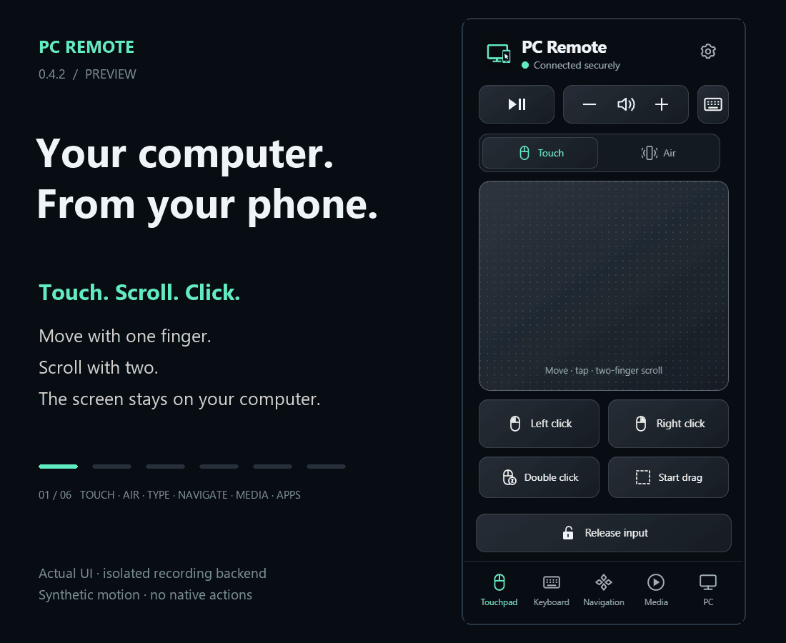
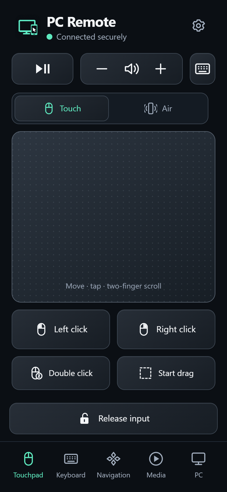
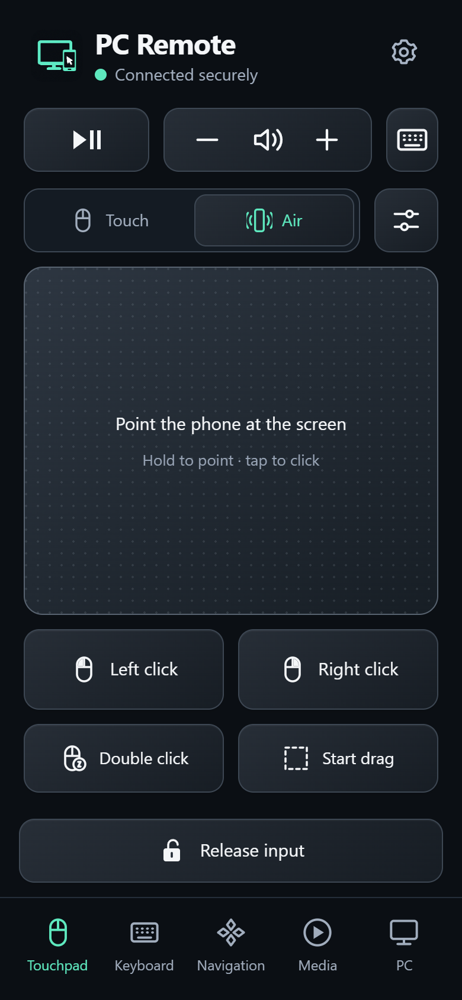
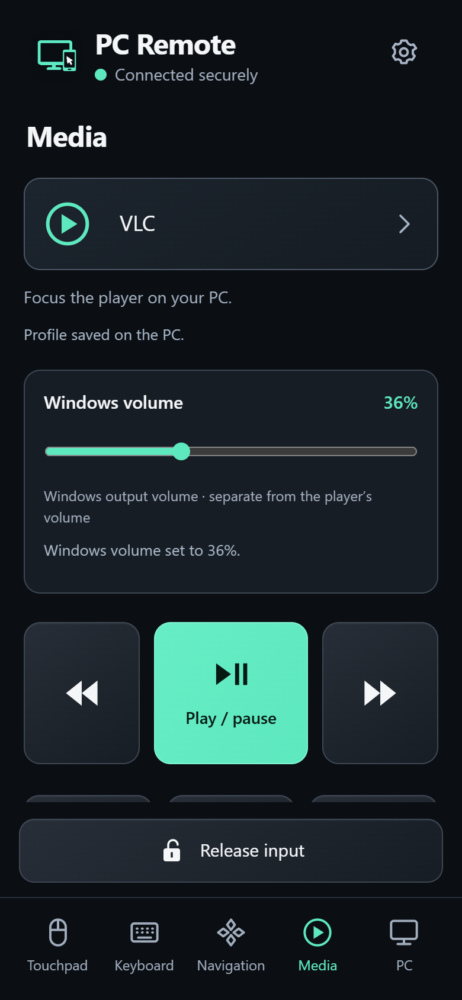
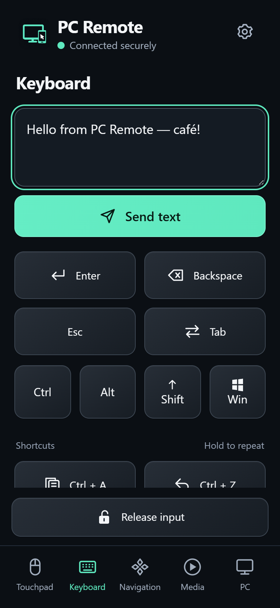
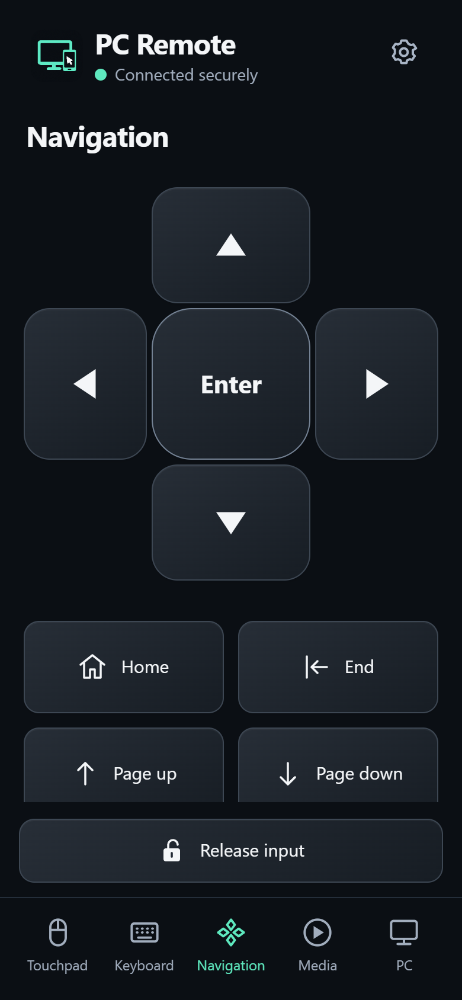
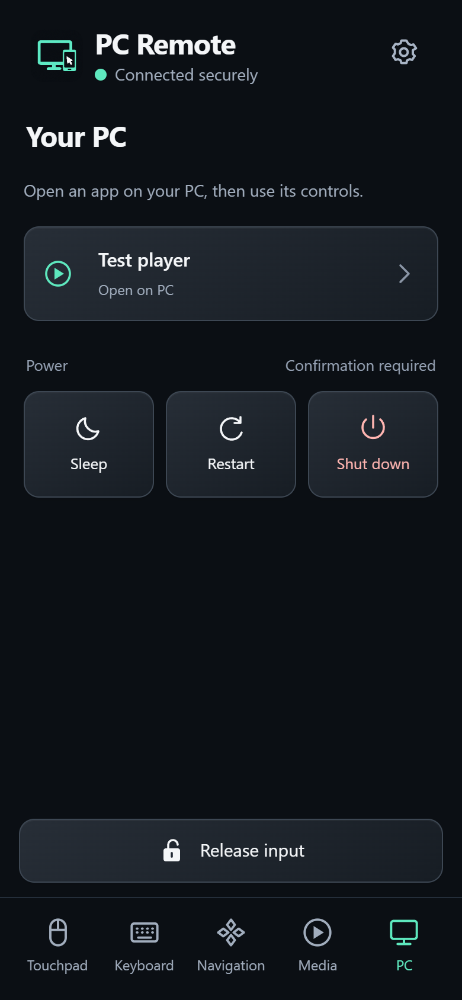
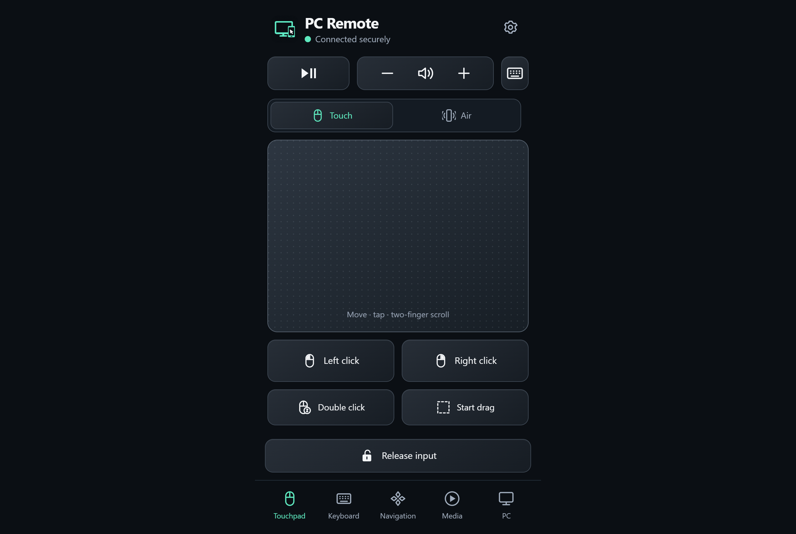

<div align="center">


# PC Remote

### Your computer, from the comfort of your phone.

Turn your browser into a touchpad, an Air pointer, a keyboard and a media remote.<br>
Run the companion on your computer. Pair locally. Keep your controls within reach.

[](https://github.com/maamouribilel/pc-remote/releases/tag/v0.4.2) [](#compatibility) [](#compatibility) [](#compatibility) [](LICENSE)

**[Download](#download)** · **[See it in action](#demo)** · **[Set it up](#getting-started)** · **[User guide](docs/setup.md)** · **[Build from source](docs/development.md)**



<sub>Actual browser UI, captured with an isolated recording backend. Air uses synthetic motion; no desktop input or power action is executed. [Capture notes](docs/assets/README.md).</sub>

</div>

## A remote for the screen across the room

Watch your computer's screen while your phone handles the controls. PC Remote serves its browser app directly from the companion over **HTTPS + WSS** on your trusted local network. All web assets and the .NET runtime are bundled: packaged use needs no cloud account, subscription, Node.js or separate .NET installation.

| Control | What you can do |
| :--- | :--- |
| **Touchpad** | Move with one finger, tap to click, scroll with two fingers, right/double click, and explicitly start/end a drag. |
| **Air pointer** | Select **Air**, hold your thumb on the pad and turn your wrist. Lift to stop and re-grip; tap to click. Adjust speed and invert either axis on your phone. |
| **Keyboard & navigation** | Compose text, including accents and emoji, then tap **Send text**. Use modifiers, shortcuts, large arrows, Enter, Home/End and Page keys. |
| **Media & volume** | Choose General, YouTube, VLC or Stremio controls. Set the current system output volume with read-back. Player shortcuts need the matching player in focus. |
| **App launcher** | Open locally configured apps and switch to their media profile. Configure up to 24 entries in the companion; the browser sends app IDs. |
| **Power** | Confirm a supported action, then cancel during its 30-second countdown. Windows supports sleep/restart/shutdown; macOS supports sleep; Ubuntu exposes permitted logind actions. |
| **Session controls** | Approve and revoke browsers on the computer, explicitly take over control, pause from the companion, or tap **Release input**. |

PC Remote controls the desktop you can see. Screen streaming, internet access, file transfer, clipboard synchronization and Wake-on-LAN are outside its scope. See [current limitations](docs/limitations.md).

## Download

**Current release: [v0.4.2 preview](https://github.com/maamouribilel/pc-remote/releases/tag/v0.4.2).** Windows is the primary platform; macOS and Ubuntu companions are experimental.

| Your computer | Download | Setup |
| :--- | :--- | :--- |
| **Windows x64** | **[Installer](https://github.com/maamouribilel/pc-remote/releases/download/v0.4.2/PCRemote-0.4.2-win-x64-setup.exe)** · [Portable ZIP](https://github.com/maamouribilel/pc-remote/releases/download/v0.4.2/PCRemote-0.4.2-win-x64.zip) | [Windows guide](docs/setup.md#windows-companion) |
| **macOS · Apple Silicon** | [Experimental ZIP](https://github.com/maamouribilel/pc-remote/releases/download/v0.4.2/PCRemote-0.4.2-osx-arm64.zip) | [macOS guide](docs/macos-setup.md) |
| **macOS · Intel** | [Experimental ZIP](https://github.com/maamouribilel/pc-remote/releases/download/v0.4.2/PCRemote-0.4.2-osx-x64.zip) | [macOS guide](docs/macos-setup.md) · Intel hardware untested |
| **Ubuntu 24.04 x64 · GNOME** | [Experimental archive](https://github.com/maamouribilel/pc-remote/releases/download/v0.4.2/PCRemote-0.4.2-linux-x64.tar.gz) | [Ubuntu guide](docs/linux-setup.md) |

[SHA-256 checksums](https://github.com/maamouribilel/pc-remote/releases/download/v0.4.2/SHA256SUMS.txt) · [Release notes](https://github.com/maamouribilel/pc-remote/releases/tag/v0.4.2) · [All versions](https://github.com/maamouribilel/pc-remote/releases) · [Download help](docs/releases.md)

Downloads are unsigned. Windows may show SmartScreen/Unknown publisher; macOS builds have an ad-hoc seal but no Developer ID signature or notarization. Read the platform guide and compare the download with `SHA256SUMS.txt`. GitHub's **Source code** archives require a development build.

### What's new

- **Air pointer, introduced in 0.4.0 and corrected in 0.4.1.** Point with your wrist using the phone's gyroscope. Motion readings stay on the phone; only pointer movement is sent. Flat-grip directions were confirmed on an iPhone; other grips, full permission/lifecycle acceptance and Android remain pending. [How to use Air](docs/setup.md#air-pointer).
- **macOS network fix in 0.4.2.** Peer-to-peer Wi-Fi record updates no longer revoke the approved LAN. On the developer's installed build, approval survived ten bursts over twelve minutes with a paired iPhone; the user reported continued control and reconnection after auto-lock. Real network changes, sleep and user switches still require approval again. Longer sessions and other Macs remain unverified. [Evidence](docs/release-evidence.md#version-042-publication-and-public-verification-2026-10-15).
- **Experimental macOS and Ubuntu companions, since 0.3.0.** A shared dashboard, platform-aware controls, explicit network approval and OS-backed credential storage accompany the existing Windows tray app. Packaged builds include .NET 10.0.13. [Compatibility and acceptance](docs/release-readiness.md).

## Getting started

You need a signed-in computer, a browser device on the same trusted network, and access to the computer to approve pairing. iPhone Safari is the verified onboarding path.

1. **Start the companion.** On Windows, run the installer or extract the complete portable ZIP and open `PCRemote-win-x64/PcController.App.exe`. Use a **Private** Windows network and the companion's scoped firewall setup if needed. On macOS/Ubuntu, follow the platform guide, grant required local permissions, approve the trusted network and deliberately resume control.
2. **Trust your computer's public certificate.** Export the public profile/root from the companion and compare its fingerprint. On iPhone, install the profile, then enable full trust under **Settings → General → About → Certificate Trust Settings**. [Certificate instructions](docs/certificates.md).
3. **Pair and approve.** Generate a pairing link, scan its QR and open the exact HTTPS address in your browser. Name the device, tap **Request PC approval**, then approve it on the computer. Pairing links last two minutes and are single use.
4. **Try the touchpad.** Move, tap and scroll while watching the computer. On iPhone, optionally use Safari **Share → Add to Home Screen**; the Home Screen app may require separate approval. [Two-minute tour](docs/demo.md).

Remembered browser authentication lasts 30 days and can be revoked immediately. One browser owns input at a time; **Take over control** explicitly replaces it. A certificate warning needs to be resolved before use. After an address change, open the companion's new address.

**Updating a Mac?** Keep the app in its stable location, use **Allow Keychain access after update…** for the existing key, and review Accessibility before approving the network again. [Update and recovery steps](docs/macos-setup.md).

<a id="walkthrough"></a>

## Demo

The animation above tours the **actual 0.4.2 browser interface**: Touch → Air → Keyboard → Navigation → Media → PC. It uses the isolated test fixture, recording adapters and a synthetic gyroscope. The test launcher and volume read-back illustrate the controls; no physical app, audio output or power action is exercised.

**[Follow the two-minute hands-on demo →](docs/demo.md)** for the same sequence on your own paired computer, including motion access, hold-to-point, sending text and choosing a media profile.

<table>
  <tr>
    <td align="center" width="33%"><strong>Touch</strong><br></td>
    <td align="center" width="33%"><strong>Air</strong><br></td>
    <td align="center" width="33%"><strong>Media</strong><br></td>
  </tr>
</table>

<details>
<summary>Keyboard, navigation, apps and desktop browser</summary>

| Keyboard | Navigation | Apps |
| :---: | :---: | :---: |
|  |  |  |



The native Windows dashboard is pictured in the [setup guide](docs/setup.md#windows-companion). Mac/Ubuntu use the shared dashboard; those native windows were not captured in this refresh. [Media provenance](docs/assets/README.md).

</details>

## Compatibility

<a id="supported-environments"></a>

| Companion | Status and actual evidence |
| :--- | :--- |
| **Windows 10 1809+ x64** | Primary; Windows 11 tested. Native input, audio, launcher, power and physical iPhone use were recorded on 0.2.x. Current 0.3.x/0.4.x Windows builds have hosted regression, DPAPI, browser and TLS checks; physical installation/phone revalidation is pending. |
| **macOS 14+ · Apple Silicon** | Experimental; tested on macOS 27. Native guarded input smoke, Keychain storage and iPhone control recorded. Installed 0.4.2 approval survived ten peer-to-peer Wi-Fi bursts over twelve minutes with a paired iPhone; longer sessions and other Macs remain unverified. |
| **macOS 14+ · Intel** | Experimental; cross-build/package checks and metadata startup under Rosetta. Intel hardware untested. |
| **Ubuntu 24.04 x64 · GNOME** | Experimental; isolated Xvfb/GTK, portal protocol and encrypted keyring checks. Real GNOME X11/Wayland desktop acceptance pending. Wayland requires Remote Desktop consent; text requires explicit GTK opt-in. |

| Browser remote | Status |
| :--- | :--- |
| **iPhone Safari / Home Screen app** | Certificate trust and touch control verified on hardware; separate later iPhone/macOS and flat-grip Air evidence. Full current Air acceptance remains pending. |
| **Chromium-based browsers** | Automated Chromium/Edge checks at phone portrait, landscape and desktop sizes. These are viewport checks, not Android hardware evidence. |
| **Desktop browser** | Desktop layout covered by automated checks; trust and pairing are still required. |
| **Android, iPad, Firefox** | Untested; certificate onboarding and motion support have not been verified. |

Supported controls depend on companion capabilities and local permissions. Mac restart/shutdown stay unavailable; Ubuntu power requires permission without an authentication prompt. Media, launcher focus, login startup and physical power acceptance have platform-specific gaps. [Full support matrix](docs/release-readiness.md) · [Limitations](docs/limitations.md) · [Dated validation](docs/release-evidence.md).

## Help and documentation

| I want to… | Read |
| :--- | :--- |
| Install, pair and learn the controls | [Setup & everyday use](docs/setup.md) · [Two-minute demo](docs/demo.md) |
| Configure macOS or Ubuntu | [macOS](docs/macos-setup.md) · [Ubuntu](docs/linux-setup.md) |
| Enable Air or recover motion permission | [Air pointer](docs/setup.md#air-pointer) |
| Configure apps, volume or power | [Companion features](docs/pc-features.md) |
| Fix trust, connection or input issues | [Certificates](docs/certificates.md) · [Troubleshooting](docs/troubleshooting.md) |
| Check support and known gaps | [Limitations](docs/limitations.md) · [Release readiness](docs/release-readiness.md) |
| Share or promote PC Remote | **Illustrated promo video** (28 s): [16:9](docs/promo/pc-remote-ad-28s.mp4) · [9:16 vertical](docs/promo/pc-remote-ad-28s-vertical.mp4). An animation that redraws the UI, not a screen capture. [About the video](docs/promo/README.md) |
| Build, test or contribute | [Development guide](docs/development.md) · [Protocol](docs/protocol.md) · [Security policy](.github/SECURITY.md) |
| Package or publish a release | [Release procedure](docs/releases.md) · [Release checklist](docs/release-checklist.md) |

## Build from source

Windows, in PowerShell 7:

```powershell
git clone https://github.com/maamouribilel/pc-remote.git
Set-Location pc-remote
./scripts/install-tools.ps1
./scripts/build.ps1 -Configuration Release
./scripts/run.ps1 -Configuration Release
```

macOS/Ubuntu, with the pinned native tools and platform prerequisites:

```sh
git clone https://github.com/maamouribilel/pc-remote.git
cd pc-remote
python3 scripts/portable.py build
python3 scripts/portable.py desktop
```

Pinned inputs: **.NET SDK 10.0.402**, **Node 24.21.0**, **npm 11.19.0**; TypeScript 7, Vite 8 and Avalonia 12.1.4. There is no required `.env`, API key or database. [Development commands, architecture and validation](docs/development.md).

<details>
<summary>Windows packaging outputs</summary>

```powershell
./scripts/package.ps1 -Version 0.4.2
Get-Content ./artifacts/latest-release.txt
```

Creates `PCRemote-0.4.2-win-x64-setup.exe`, `PCRemote-0.4.2-win-x64.zip`, the self-contained `PCRemote-win-x64/` folder and `SHA256SUMS.txt` in a new timestamped directory. Review [release requirements](docs/releases.md#publishing-the-next-version) before distribution. Generated packages and local credentials stay out of Git. Published assets are immutable.

</details>

Coding agents must read [AGENTS.md](AGENTS.md); Claude also reads [CLAUDE.md](CLAUDE.md). New releases synchronize source, documentation, agent instructions, tags and assets. Use the [release checklist](docs/release-checklist.md).

## License

[MIT](LICENSE). Dependencies retain their own terms; packages include the relevant runtime, library and native notices. See [third-party components and build tools](docs/third-party.md).
